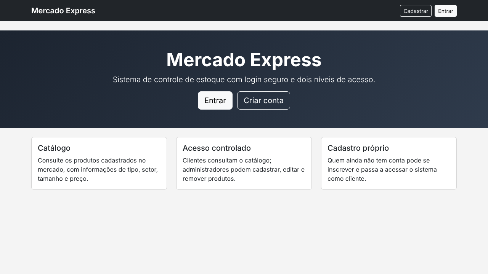
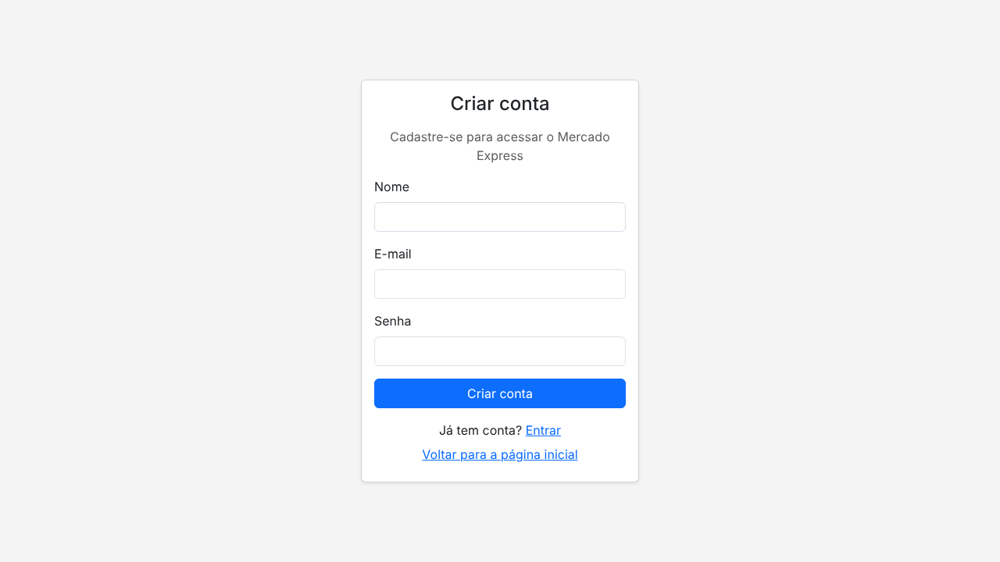
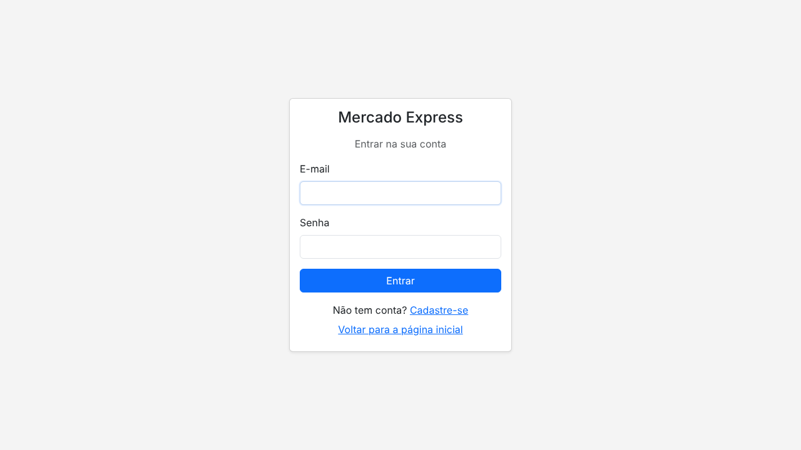
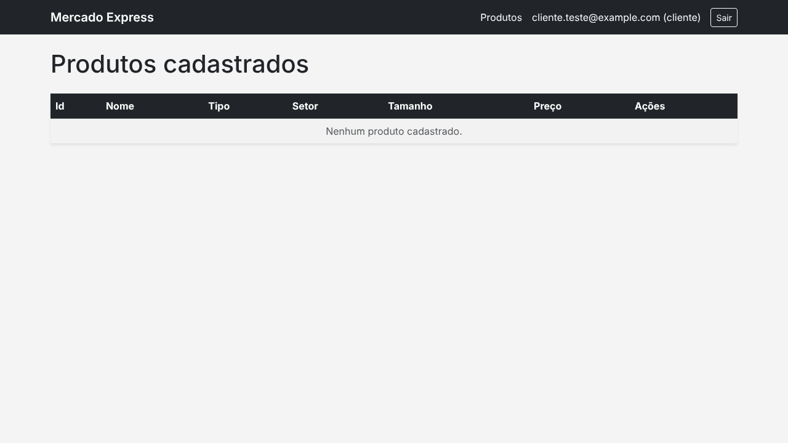
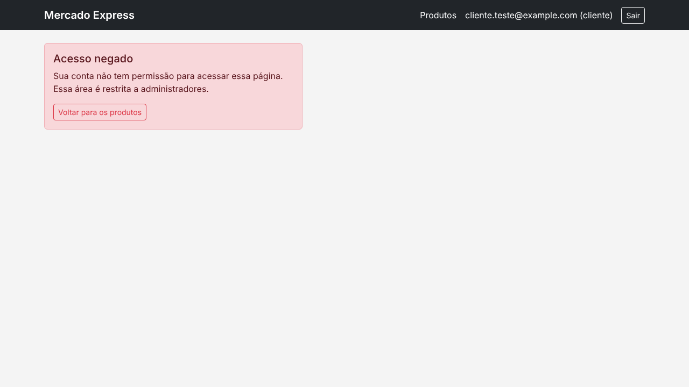
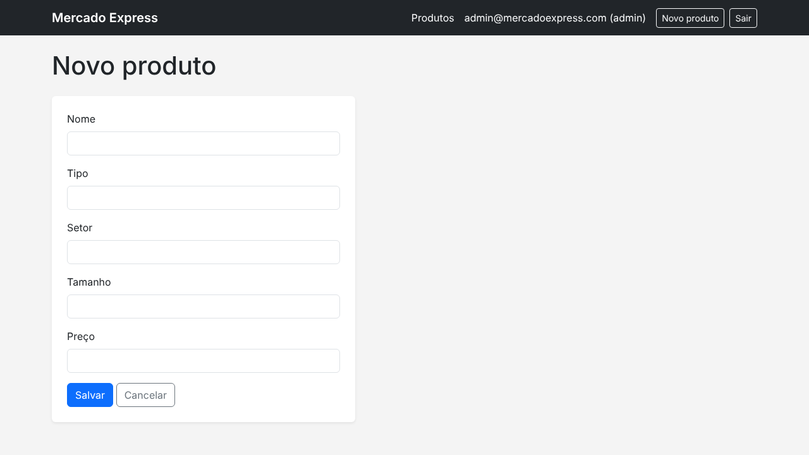
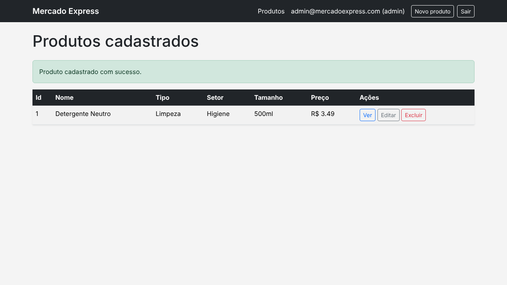
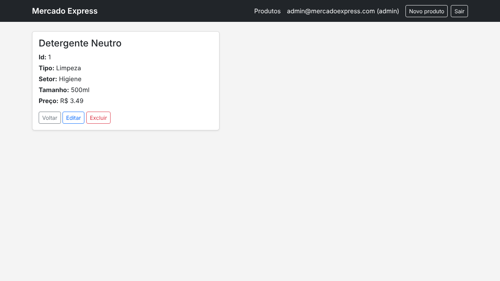
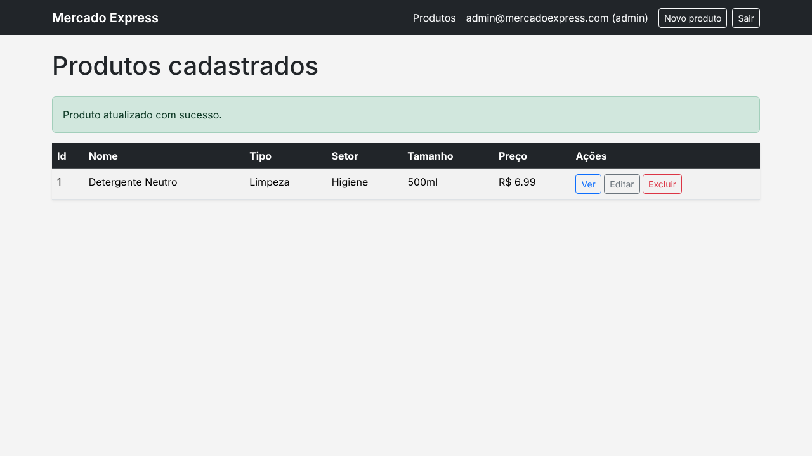
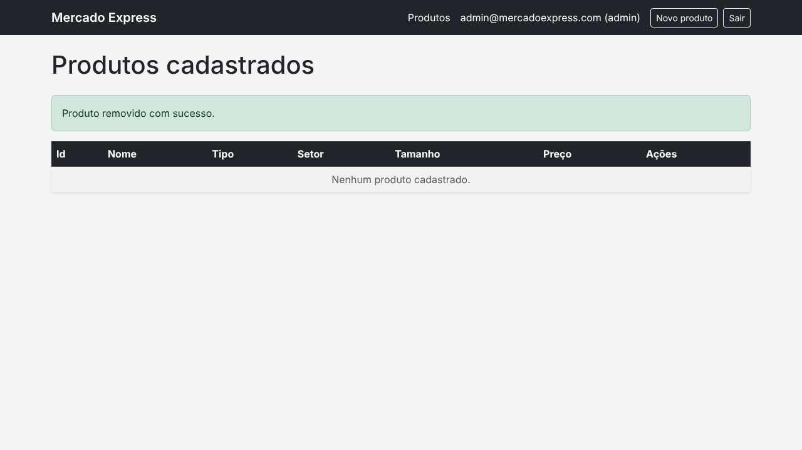

# Mercado Express - Security

Trabalho de Checkpoint 5 (Parte 1 - Spring Security MVC, Deploy e PostgreSQL) da disciplina de TDS, FIAP, sob orientação do professor Dr. Marcel Stefan Wagner.

Este repositório dá continuidade ao domínio "mercado express" dos checkpoints anteriores, agora com persistência em PostgreSQL e autenticação própria: uma tela de login diferente da padrão do Spring Security, cadastro de novos usuários (Sign Up) e dois níveis de acesso distintos para quem usa o sistema.

A aplicação está publicada e em funcionamento em: **https://mercado-express-cp5-security.onrender.com**

## Integrantes

- Nicolas Monteiro Ramiro - RM 562380
- Marcus Vinicius Vila Nova da Silva - RM 558771
- Hebert Lopes dos Santos - RM 563192

IDE utilizada no desenvolvimento: **IntelliJ IDEA**.

## Tecnologias utilizadas

- Java 17
- Spring Boot 3.3.4, com os módulos Web, Thymeleaf, Data JPA, Security e Validation
- Maven
- Lombok, usado nas entidades `Produto` e `Usuario`
- PostgreSQL, acessado via Spring Data JPA, com configuração em `application.yml`
- Spring Security, com autenticação própria contra o banco de dados e dois papéis de usuário
- Bootstrap 5, para o layout das telas
- Docker e Render, para o deploy

## Estrutura de dados

### Produtos

Os produtos são armazenados na tabela `TDS_SEC_MVC_TB_MERCADO`:

| Coluna  | Tipo          | Descrição                                   |
|---------|---------------|----------------------------------------------|
| ID      | BIGINT        | Identificador do produto, gerado automaticamente |
| NOME    | VARCHAR(100)  | Nome do produto                             |
| TIPO    | VARCHAR(50)   | Categoria do produto (ex: Limpeza)          |
| SETOR   | VARCHAR(50)   | Setor do mercado onde o produto fica (ex: Higiene) |
| TAMANHO | VARCHAR(20)   | Tamanho ou embalagem do produto (ex: 500ml) |
| PRECO   | NUMERIC(10,2) | Preço unitário do produto                   |

### Usuários

Os usuários cadastrados (via Sign Up ou criados pela aplicação) ficam na tabela `TDS_USERS_MERCADO`:

| Coluna | Tipo         | Descrição                                      |
|--------|--------------|--------------------------------------------------|
| ID     | BIGINT       | Identificador do usuário, gerado automaticamente |
| NOME   | VARCHAR(100) | Nome do usuário                                  |
| EMAIL  | VARCHAR(150) | E-mail (único), usado como login                 |
| SENHA  | VARCHAR(255) | Senha, armazenada com hash BCrypt                |
| PAPEL  | VARCHAR(20)  | `ADMIN` ou `CLIENTE`                             |

As tabelas são criadas automaticamente pelo Hibernate na primeira execução da aplicação.

## Autenticação e autorização

A tela de `index.html` é a landing page (rota `/`), pública para qualquer visitante. A partir dela é possível entrar (`/login`) ou criar uma conta (`/cadastro`).

**Login customizado:** a tela de login (`templates/login.html`) foi construída do zero com Thymeleaf e Bootstrap - não é a tela padrão gerada pelo Spring Security.

**Cadastro (Sign Up):** quem ainda não tem conta é direcionado para `/cadastro`, preenche nome, e-mail e senha, e passa a existir na tabela `TDS_USERS_MERCADO` com o papel `CLIENTE`. A senha nunca é salva em texto puro - é codificada com BCrypt antes de persistir.

**Dois tipos de usuário:**

| Papel     | Acesso                                                                 |
|-----------|-------------------------------------------------------------------------|
| `CLIENTE` | Consulta a listagem e o detalhe dos produtos (somente leitura)          |
| `ADMIN`   | Além da leitura, pode cadastrar, editar e excluir produtos              |

Um usuário `ADMIN` já é criado automaticamente na primeira inicialização da aplicação (ver variáveis `ADMIN_EMAIL` / `ADMIN_SENHA` abaixo), para que a área restrita de administração possa ser testada sem acesso direto ao banco.

Após o login, o usuário é redirecionado para `/produtos`, a área de acesso restrito - rota que não pode ser acessada sem autenticação. Uma tentativa de acessar uma rota exclusiva de `ADMIN` estando logado como `CLIENTE` é bloqueada com uma página de acesso negado própria (não a página de erro padrão do Spring).

## Telas e rotas

| Rota                        | Método | Ação                                  | Acesso              |
|------------------------------|--------|----------------------------------------|----------------------|
| `/`                          | GET    | Landing page (`index.html`)            | Público              |
| `/cadastro`                  | GET/POST | Criação de conta (Sign Up)           | Público              |
| `/login`                     | GET    | Tela de login customizada              | Público              |
| `/produtos`                  | GET    | Lista os produtos cadastrados          | Autenticado          |
| `/produtos/{id}`             | GET    | Exibe o detalhe de um produto          | Autenticado          |
| `/produtos/novo`             | GET/POST | Cadastro de um novo produto          | Somente ADMIN        |
| `/produtos/{id}/editar`      | GET/POST | Edição de um produto                 | Somente ADMIN        |
| `/produtos/{id}/excluir`     | POST   | Remoção de um produto                  | Somente ADMIN        |

### Landing page

### Criar conta (Sign Up)

### Login customizado

Quem tenta acessar `/produtos` sem estar autenticado é redirecionado para esta tela:

### Área restrita como CLIENTE

Um usuário comum vê a listagem de produtos, mas não tem acesso aos botões de cadastro/edição/exclusão:

Se tentar acessar diretamente uma rota de administrador (ex: `/produtos/novo`), é bloqueado com a página de acesso negado:

### Cadastro de um novo produto (CREATE) - somente ADMIN

Após salvar, o produto aparece na listagem:

### Detalhe do produto (READ)

### Atualização de um produto (UPDATE) - somente ADMIN

### Remoção de um produto (DELETE) - somente ADMIN

## Deploy

A aplicação está publicada no Render, com build automatizado a partir do `Dockerfile` e do `render.yaml` presentes no repositório, conectada a um banco PostgreSQL também hospedado no Render.

- Aplicação publicada: **https://mercado-express-cp5-security.onrender.com**
- Repositório GitHub: https://github.com/lopesadvisory/mercado-express-cp5-security

## Executando o projeto localmente

Para rodar a aplicação fora do Render (por exemplo, no IntelliJ), é necessário um PostgreSQL acessível e configurar as seguintes variáveis de ambiente antes de iniciar a classe `MercadoExpressSecurityApplication`:

- `DB_URL` - string de conexão JDBC (ex: `jdbc:postgresql://localhost:5432/mercado_express`)
- `DB_USER` - usuário do PostgreSQL
- `DB_PASSWORD` - senha do PostgreSQL
- `ADMIN_NOME` - nome do usuário administrador criado automaticamente (opcional, padrão `Administrador`)
- `ADMIN_EMAIL` - e-mail do usuário administrador (opcional, padrão `admin@mercadoexpress.com`)
- `ADMIN_SENHA` - senha do usuário administrador (opcional, padrão `admin123`)

Nenhuma credencial fica salva no código ou no repositório - elas são lidas em tempo de execução a partir dessas variáveis. Com elas configuradas, a aplicação sobe em `http://localhost:8083`.
